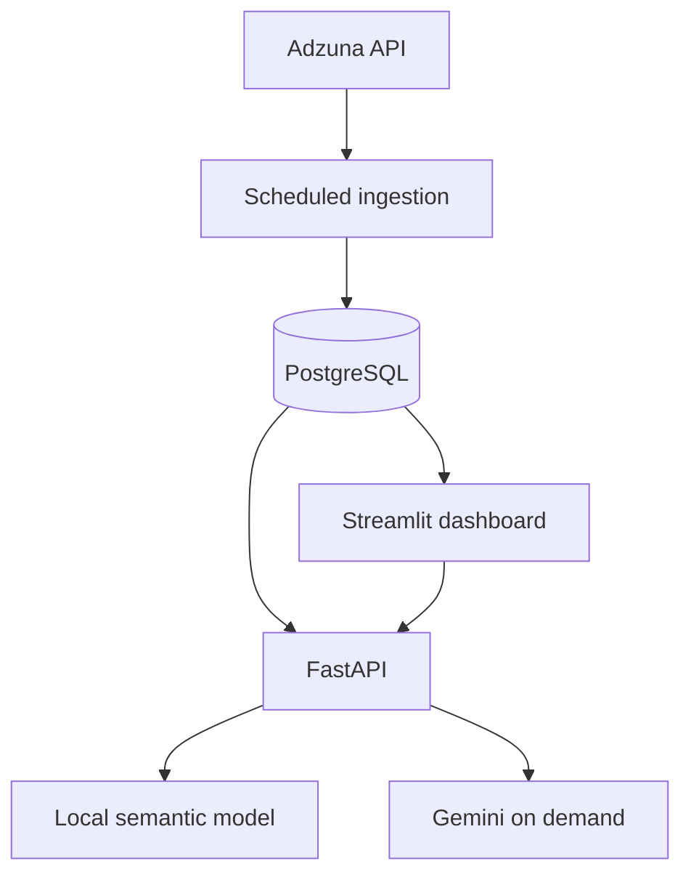

# CareerPulse AI

[](https://github.com/SNDLM/careerpulse-ai/actions/workflows/ci.yml)

I built CareerPulse to practise the full path from collecting job data to making it useful. It retrieves technology job offers, cleans and stores them, then lets me explore the results through an API and a dashboard.

The project focuses on Madrid. It uses the Adzuna API for job offers and a small CSV fixture for development and tests.


## What it does

- Retrieves job offers from Adzuna through a scheduled ingestion process.
- Cleans the records and standardizes technology names.
- Stores offers in PostgreSQL, updating existing records from the same source instead of duplicating them.
- Exposes filtering, pagination and summary statistics through FastAPI.
- Shows Madrid offers, filters and charts in a Streamlit dashboard.
- Searches offers by meaning with a local multilingual embedding model.
- Generates an explanation for a selected offer on demand using Gemini.
- Runs automated tests and code checks in GitHub Actions.

## How it works



The ingestion service fetches offers when it starts and repeats the process approximately every 24 hours while the container is running. The CSV fixture is used for development and testing.

## Explore the data

The dashboard shows stored offers whose location contains Madrid. You can filter by source, detected technology and remote status, or search by title and company. It also shows counts by job profile and technology.

These charts describe **the offers currently stored in this project**. They are not estimates of the entire Madrid job market. Salaries are shown only when an offer provides them.

## Search and AI features

The semantic search compares a natural-language query with job titles, technologies and descriptions using the locally loaded `intfloat/multilingual-e5-small` model. It can retrieve related offers even when the query does not use exactly the same words as the listing. Only Madrid offers with a non-empty description are included.

For a selected offer, the API can also request a short explanation from Gemini about its relationship to a search query. This call is made on demand; ordinary filtering and semantic search do not need Gemini to generate a response.

I ran a small exploratory check of semantic search against stored offers. The examples, results and limitations are described in [the search evaluation](docs/semantic-evaluation.md). It is a diagnostic exercise, not a claim of general search accuracy.

## API

FastAPI provides interactive documentation at `/docs` while the application is running.

| Method | Endpoint | Purpose |
| --- | --- | --- |
| GET | `/health` | Check that the API is running |
| GET | `/jobs` | List and filter offers |
| GET | `/jobs/{job_id}` | Retrieve one offer |
| GET | `/stats/summary` | View counts and salary summaries |
| GET | `/jobs/semantic-search` | Find offers related to a natural-language query |
| POST | `/jobs/{job_id}/explanation` | Explain a selected offer in relation to a query |

`GET /jobs` supports the `technology`, `location`, `remote` and `source` filters. Use `limit` and `offset` for pagination.

Examples:

```text
/jobs?location=Madrid&source=adzuna&limit=20&offset=0
/jobs/semantic-search?q=ingenieria%20de%20datos&limit=3
```

The explanation endpoint accepts the search text in the `q` query parameter and requires a configured Gemini API key.

## Run locally with Docker

You need Docker with Compose, Adzuna API credentials and a Gemini API key for the full configuration in `compose.yaml`.

Clone the repository and create your local environment file:

```powershell
git clone https://github.com/SNDLM/careerpulse-ai.git
cd careerpulse-ai
Copy-Item .env.example .env
```

Fill in the placeholder values in `.env`. **Do not commit this file or share your real keys.**

Build the image and start the services:

```powershell
docker build -t careerpulse-ai:local .
docker compose up -d
```

Open:

- Dashboard: [http://localhost:8501](http://localhost:8501)
- API documentation: [http://localhost:8000/docs](http://localhost:8000/docs)
- Health check: [http://localhost:8000/health](http://localhost:8000/health)

To inspect the scheduled ingestion:

```powershell
docker compose logs ingestion
```

To stop the containers:

```powershell
docker compose down
```

The PostgreSQL data is stored in a Docker volume, so `docker compose down` does not delete it. The services run on your computer; this repository does not currently provide a hosted public demo.

The first semantic search may take longer while the local model is downloaded and loaded. Gemini requests depend on the limits and availability of your API account.

## Run the checks

With Python 3.12 and the development dependencies installed in `.venv`:

```powershell
.\.venv\Scripts\python.exe -m pytest -v
.\.venv\Scripts\python.exe -m ruff check .
```

GitHub Actions also runs the project's automated checks when changes are pushed.

## Built with

Python 3.12 · PostgreSQL · Psycopg · FastAPI · Streamlit · pandas · Sentence Transformers · Gemini API · Docker Compose · pytest · Ruff · GitHub Actions

## Limitations

The stored dataset is small and depends on the offers returned by Adzuna. The descriptions inspected during the initial search evaluation were 500 characters long, sometimes leaving more space for company introductions than for technical details. Technology detection and the remote indicator use rules, so they can be wrong. AI-generated explanations should be checked against the original offer.

The next meaningful improvement would be to label a larger, fixed set of search queries and relevant offers before comparing ranking methods.

## Author

Sergio Nieto de la Morena · [GitHub](https://github.com/SNDLM)