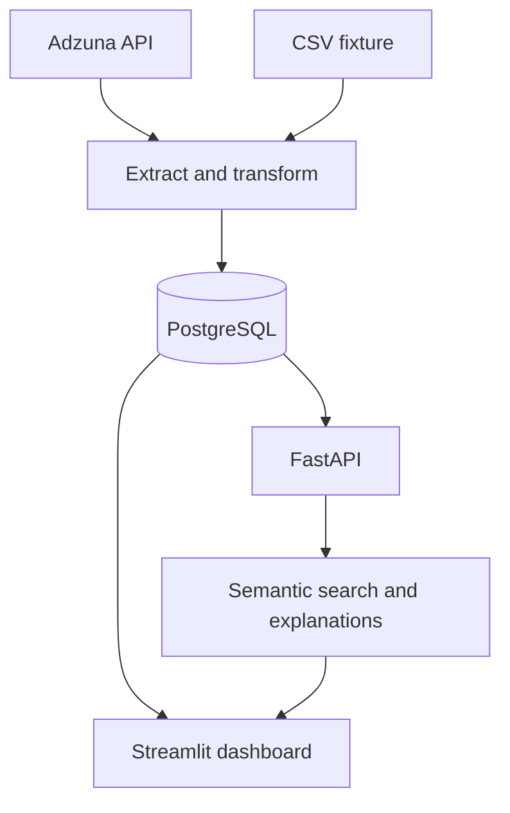

# CareerPulse AI

[](https://github.com/SNDLM/careerpulse-ai/actions/workflows/ci.yml)

I built CareerPulse to practise the full path from raw job offers to a usable application: collecting data, cleaning it, storing it, and making it available through an API and a dashboard.

The project focuses on technology jobs in Madrid. It combines offers from Adzuna with a small CSV fixture used for development and testing. The dataset is a demonstration sample, not a measure of the entire job market.


## What it does

- Collects job offers from Adzuna and reads sample jobs from CSV.
- Cleans records and standardizes known technology names.
- Stores offers in PostgreSQL, using the source and source job ID to avoid duplicates.
- Refreshes Adzuna offers while the ingestion container is running.
- Provides a FastAPI service for filtering, pagination and summary statistics.
- Displays Madrid offers, charts and filters in a Streamlit dashboard.
- Finds relevant offers with a local multilingual embedding model.
- Uses Gemini on demand to explain how an offer relates to a search.
- Runs tests and code checks with GitHub Actions.

## Data flow



The ingestion process retrieves Adzuna offers when it starts and repeats the request approximately every 24 hours while Docker is running.

## Dashboard

The dashboard shows stored offers whose location contains Madrid. You can filter them by source, detected technology and remote status, or search by title and company. It also shows counts by job profile and technology.

The **Buscar ofertas con IA** section searches by meaning rather than requiring the same words to appear in an offer. Open a result and click **Explicar con IA** to request a short explanation. Gemini is called only when you click that button.

The charts count offers currently stored in this project. They do not estimate the size of the Madrid job market.

## How the AI features work

Semantic search runs locally with the `intfloat/multilingual-e5-small` embedding model. It compares a search query with the saved job descriptions and ranks the closest matches. A similarity score indicates how closely the texts match; it is not a guarantee that the job is suitable for a particular person.

The explanation feature sends the search query and selected offer details to the Gemini API. It asks for a short explanation based on information present in the offer. It does not use a candidate's CV or claim to know their qualifications.

The first semantic search may take longer while the local model is downloaded. Gemini requires an API key and is subject to the provider's usage limits.

## API

FastAPI provides interactive documentation at `/docs` while the API is running.

| Endpoint | Purpose |
| --- | --- |
| `GET /health` | Check whether the API is running |
| `GET /jobs` | List and filter offers |
| `GET /jobs/{job_id}` | Retrieve one offer |
| `GET /stats/summary` | View job counts and salary summaries |
| `GET /jobs/semantic-search` | Rank Madrid offers by similarity to `q` |
| `POST /jobs/{job_id}/explanation` | Explain one offer in relation to `q` |

`GET /jobs` supports `technology`, `location`, `remote` and `source` filters, plus `limit` and `offset` for pagination.

Examples:

```text
GET /jobs?location=Madrid&source=adzuna&limit=20&offset=0
GET /jobs/semantic-search?q=Python%20data%20engineer&limit=3
POST /jobs/23/explanation?q=Python%20data%20engineer
```

The last example uses an ID from a local database. IDs may differ in another installation.

## Run locally with Docker

You need Docker with Compose, Adzuna API credentials and a Gemini API key. From the project directory, copy the example environment file:

```powershell
Copy-Item .env.example .env
```

Fill in the database password and API credentials in `.env`. It must include `DB_PASSWORD`, `ADZUNA_APP_ID`, `ADZUNA_APP_KEY` and `GEMINI_API_KEY`. Keep `.env` private and never commit it.

Build the image:

```powershell
docker build -t careerpulse-ai:local .
```

Start the services:

```powershell
docker compose up -d
```

**Run those commands separately, in the order shown.** The API and dashboard are available locally at:

- Dashboard: [http://localhost:8501](http://localhost:8501)
- API documentation: [http://localhost:8000/docs](http://localhost:8000/docs)
- Health check: [http://localhost:8000/health](http://localhost:8000/health)

To inspect the ingestion worker:

```powershell
docker compose logs ingestion
```

The PostgreSQL volume preserves data when you stop the services with `docker compose down`.

## Run the checks

With Python 3.12 and a virtual environment, install the development and AI dependencies:

```powershell
.\.venv\Scripts\python.exe -m pip install -e ".[dev,ai]"
```

Then run these commands **separately**:

```powershell
.\.venv\Scripts\python.exe -m pytest -v
```

```powershell
.\.venv\Scripts\python.exe -m ruff check .
```

GitHub Actions runs automated checks on pushes to the repository.

## Built with

Python 3.12 · PostgreSQL · Psycopg · FastAPI · Streamlit · pandas · Docker Compose · sentence-transformers · Gemini API · pytest · Ruff · GitHub Actions

## Limitations

The dataset is small, and many offers do not include salary information. Technology detection and the remote flag rely on rules and keywords, so individual offers may need manual verification. AI explanations depend on the information available in an offer and should be checked against its original listing.

The application currently runs locally; there is no public live demo.

## Author

Sergio Nieto de la Morena · [GitHub](https://github.com/SNDLM)