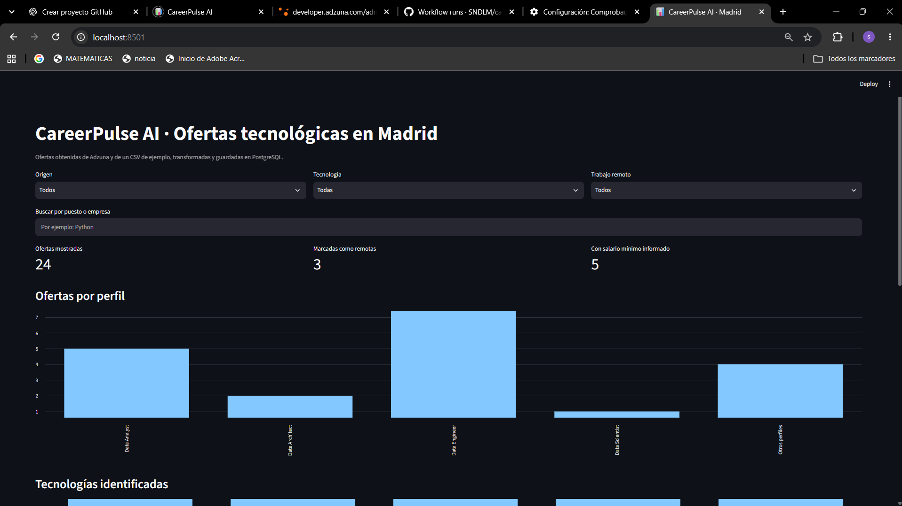
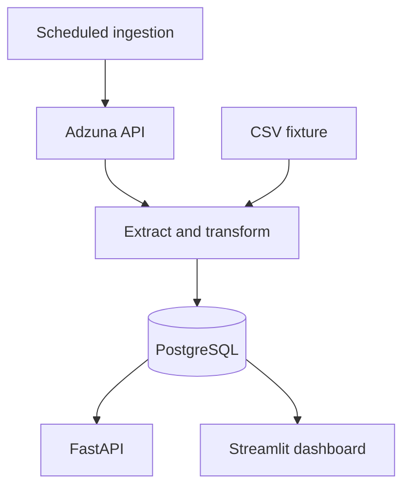

# CareerPulse AI

[](https://github.com/SNDLM/careerpulse-ai/actions/workflows/ci.yml)

I built CareerPulse to explore how a small data engineering project works from end to end: collect job offers, clean them, store them, and make the results accessible through an API and a dashboard.

The project focuses on technology jobs in Madrid. It combines offers from the Adzuna API with a small CSV fixture used for development and testing.



## What it does

- Collects job offers from Adzuna and reads jobs from a CSV file.
- Cleans job records and standardizes known technology names.
- Stores jobs in PostgreSQL without duplicating offers from the same source.
- Refreshes Adzuna offers automatically while the ingestion container is running.
- Provides a FastAPI endpoint to search and filter jobs.
- Displays Madrid offers in a Streamlit dashboard.
- Runs tests and code checks through GitHub Actions.

## How it fits together



The ingestion process retrieves Adzuna offers when it starts and repeats the request approximately every 24 hours while Docker is running.

## Dashboard

The dashboard shows offers whose location contains Madrid. You can filter by data source, detected technology and remote status, or search by job title and company.

It also shows counts by job profile and by identified technology. These are **counts from the offers currently stored**, not estimates for the whole Madrid job market.

Some offers are labelled `Unknown` because the current rule-based detector could not identify a technology in their title or description. The remote indicator is also inferred from keywords, so it may need manual verification.

## API

FastAPI provides interactive documentation at `/docs` when the application is running.

| Endpoint | Purpose |
| --- | --- |
| `GET /health` | Check whether the API is running |
| `GET /jobs` | List job offers |
| `GET /jobs/{job_id}` | Retrieve one offer |
| `GET /stats/summary` | View job counts and salary summaries |

`GET /jobs` supports `technology`, `location`, `remote` and `source` filters, plus `limit` and `offset` for pagination.

For example:

```text
/jobs?location=Madrid&source=adzuna&limit=20&offset=0
```

## Run locally with Docker

You need Docker with Compose and Adzuna API credentials. Copy the example environment file and fill in the required values:

```powershell
Copy-Item .env.example .env
```

Keep `.env` private: it contains your database password and API credentials.

Build the image and start the services from the project directory:

```powershell
docker build -t careerpulse-ai:local .
docker compose up -d
```

Once the containers are running:

- Dashboard: http://localhost:8501
- API documentation: http://localhost:8000/docs
- API health check: http://localhost:8000/health

To check the ingestion worker:

```powershell
docker compose logs ingestion
```

The containers use a PostgreSQL volume, so stopping them with `docker compose down` does not remove the stored database data.

## Run the checks

From a Python 3.12 virtual environment with the development dependencies installed:

```powershell
.\.venv\Scripts\python.exe -m pytest -v
.\.venv\Scripts\python.exe -m ruff check .
```

GitHub Actions runs the quality checks when changes are pushed.

## Built with

Python 3.12 · PostgreSQL · Psycopg · FastAPI · Streamlit · pandas · Docker Compose · pytest · Ruff · GitHub Actions

## Current limitations and next steps

This is a portfolio project, and the dataset is still small. Salary figures are only available for offers that include them. Technology and remote detection currently use rules and keywords.

The next steps are to expand the analysis, improve data quality, and publish a free live demo. Despite the project name, **there is no machine learning model or generative AI feature yet**; I plan to add one only when it solves a clear problem in the data.

## Author

Sergio Nieto de la Morena · [GitHub](https://github.com/SNDLM)